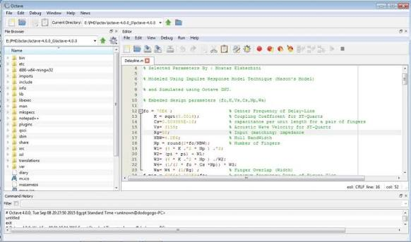
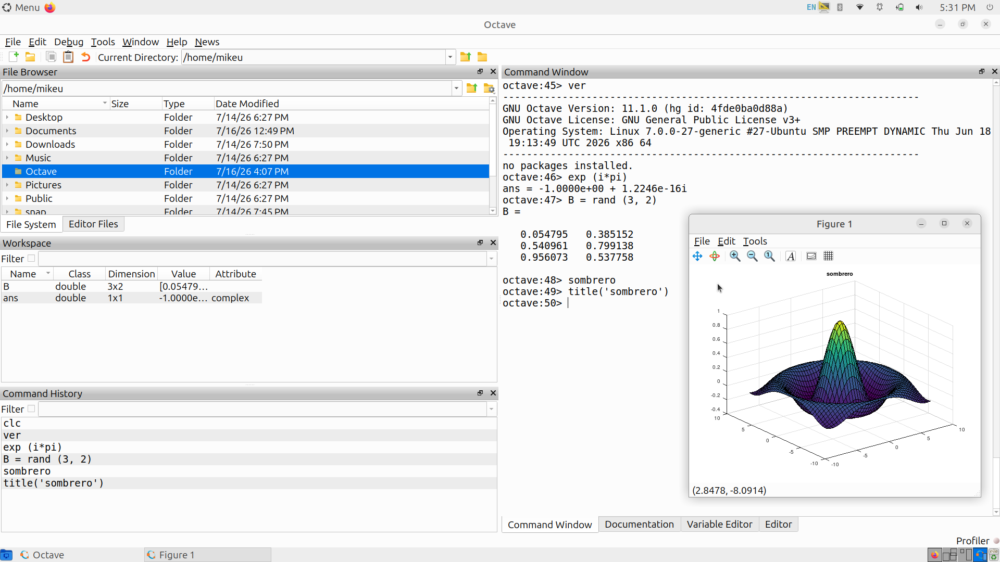

# GNU Octave Numerical Experiments With Reusable Scripts

A numerical result is easier to trust when its inputs, assumptions, and plots can be reproduced.
Use the GNU Octave GUI to inspect a calculation interactively, then keep the working steps in a script that can run again.

## Fit a small model and inspect what remains

GNU Octave treats vectors and matrices as central data types.
For a straight-line fit, put the constant and slope terms into a design matrix and solve the least-squares problem with backslash.

The following example uses five illustrative measurements:

```matlab
t = (0:4)';
y = [1.1; 2.9; 5.2; 6.8; 9.1];
A = [ones(size(t)), t];
coeff = A \ y;
residual = y - A * coeff;
printf("RMS residual: %.4f\n", sqrt(mean(residual.^2)));
```

The two coefficients describe the intercept and slope; the residual records what the fitted line does not explain.
A small residual alone does not establish that the model is appropriate outside the measured range.



For a larger sparse-matrix exercise, the supplied [README](examples/data/README) explains the origin and conversion of [west0479.mtx](examples/data/west0479.mtx) into [west0479.mat](examples/data/west0479.mat).
The compiled example [addtwomatrices.cc](examples/code/addtwomatrices.cc) demonstrates array addition through Octave's extension interface.

[](https://gnu-octave-gui.github.io/GNU-Octave/)

## Turn the result into an interpretable figure

Continue in the same session so the model variables remain available.
Overlay the measurements and fitted values, then label both axes and identify the series.

```matlab
plot(t, y, "o", t, A * coeff, "-");
xlabel("Time (s)");
ylabel("Measured response");
legend("Measurements", "Linear fit", "location", "northwest");
grid on;
print("linear-fit.png", "-dpng", "-r150");
```

The image is an output of the calculation; keep the script and input values as well.
The manual explains [plot argument combinations](https://docs.octave.org/latest/Two_002dDimensional-Plots.html) and [figure export options](https://docs.octave.org/latest/Printing-and-Saving-Plots.html).



The polynomial example's [plot.m](examples/code/%40polynomial/plot.m) delegates drawing to ordinary plotting functions.
Its [polyval.m](examples/code/%40polynomial/polyval.m) handles evaluation, while [mex_propdemo.c](examples/code/mex_propdemo.c) demonstrates reading and optionally setting a graphics-object property through MEX.

## Run the same analysis without the desktop

Save the calculation and plotting commands together in a script named analysis.m.
From a directory containing that script, an installed Octave can evaluate it without starting the GUI:

```bash
octave --no-gui --quiet --no-init-all analysis.m
```

The [command-line manual](https://docs.octave.org/latest/Command-Line-Options.html) documents these switches.
The example skips startup files so the calculation does not depend on personal initialization commands.
Graphics output still needs a usable graphics toolkit and its supporting environment.

The supplied entry-point sources are [main-cli.cc](src/main-cli.cc) and [main-gui.cc](src/main-gui.cc).
They belong to the application implementation, rather than to the analysis script.

For a more involved model, [oregonator.m](examples/code/oregonator.m) defines three coupled chemical-reaction derivatives.
Choosing a numerical solver and checking its tolerances are separate steps from defining that right-hand side.

## Check array operations before reusing MATLAB code

The gnu octave programming language is largely compatible with MATLAB, but compatibility should be checked against the actual functions and toolboxes a script uses.
Array shape, indexing, and operator meaning deserve explicit review.

| Expression | Intended calculation | Important distinction |
| --- | --- | --- |
| A * B | Matrix product | Inner dimensions must agree |
| A .* B | Element-wise product | Uses compatible array sizes and broadcasting rules |
| A ^ 2 | Matrix power | Requires a square matrix |
| A .^ 2 | Element-wise squaring | Squares each entry independently |

### Learn from the object examples

The supplied [polynomial.m](examples/code/%40polynomial/polynomial.m) stores coefficients in ascending powers.
Its [roots.m](examples/code/%40polynomial/roots.m) reverses that order before calling the ordinary root finder.
[mtimes.m](examples/code/%40polynomial/mtimes.m) implements multiplication through coefficient convolution.

Read these examples as an explanation of operator dispatch and data representation.
Their coefficient convention is not the descending-power convention expected by the ordinary numeric-vector polynomial functions.

Indexing behavior is defined in [subsref.m](examples/code/%40polynomial/subsref.m), assignment in [subsasgn.m](examples/code/%40polynomial/subsasgn.m), and conversion back to coefficients in [double.m](examples/code/%40polynomial/double.m).
[polynomial2.m](examples/code/polynomial2.m) provides a classdef-based version for comparison.

## Load the functions needed for a specialized task

gnu octave packages extend the base environment for subjects such as signal processing, statistics, and control.
Installing a package and loading its functions into the current session are separate operations.

If the signal package is already installed, this creates and displays the response of a small FIR filter:

```matlab
pkg load signal
b = fir1(20, 0.25);
freqz(b, 1);
```

The [filter cutoff](https://octave.sourceforge.io/signal/function/fir1.html) is normalized to the Nyquist frequency; it is not a frequency in hertz.
Use the [package catalog](https://gnu-octave.github.io/packages/) to find the package documentation and the [package-loading guide](https://docs.octave.org/latest/Using-Packages.html) for session behavior.

The teaching class [FIRfilter.m](examples/code/%40FIRfilter/FIRfilter.m) illustrates inheritance from the polynomial example.
Its [subsref.m](examples/code/%40FIRfilter/subsref.m) applies a filter when the object is indexed.
These example classes are distinct from the signal package's ordinary function interface.

For gnu octave online sessions, also check the provider's Octave version, available packages, and file persistence before relying on the same workflow.

## Extend a calculation only where the interface is clear

Most exploratory analysis can remain in M-files.
Compiled extensions become useful when integrating existing native code or implementing a specific performance-sensitive operation.

### Octave-native functions

- [helloworld.cc](examples/code/helloworld.cc) illustrates arguments, outputs, and a dynamically loaded function.
- [paramdemo.cc](examples/code/paramdemo.cc) inspects array properties such as negative or non-finite values.
- [funcdemo.cc](examples/code/funcdemo.cc) invokes a supplied function through the interpreter.

### MEX and embedded use

[mex_demo.c](examples/code/mex_demo.c) introduces the MEX entry point and includes a compilation example.
[embedded.cc](examples/code/embedded.cc) creates an interpreter inside a C++ application.
Building either requires the appropriate development libraries and toolchain for the installed Octave version.

## Related Search Terms

GNU Octave GUI, GNU Octave, gnu octave online, gnu octave packages, gnu octave programming language, octave, numerical-computing, scientific-computing, linear-algebra, data-visualization, signal-processing, matlab, mathematics, scripting, open-source
